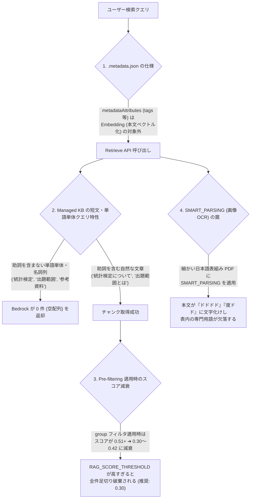

# Amazon Bedrock Managed Knowledge Base 検索仕様・トラブルシューティングガイド

本ドキュメントは、`mini-aigw` が採用している **Amazon Bedrock Managed Knowledge Base（`type: MANAGED` / `managedSearchConfiguration`）** の実機検証で明らかになった検索仕様、検索がヒットしない典型的な原因（アンチパターン）、および本システムにおける対策アーキテクチャを記録した技術仕様書です。

---

## 1. 背景：アップロード・同期済みでも RAG 検索にヒットしない 4 つの原因

S3 バケットへ PDF 等のドキュメントと `.metadata.json` をアップロードし、Bedrock Knowledge Base の同期（Ingestion Job）が `COMPLETE`（ドキュメントステータス `INDEXED`）になっていても、以下の **4 つの仕様・要因** により RAG 単体テストや対話シミュレーションでヒットしないケースが発生します。



---

## 2. 仕様詳細と実機検証データ

### 2.1 【仕様①】単語単体・キーワード羅列クエリで 0 件になる現象

Amazon Bedrock の `MANAGED` 型 Knowledge Base（`managedSearchConfiguration`）は、内部のクエリ分類・ハイブリッド検索エンジンの仕様により、**助詞や述語を含まない名詞単体・スペース区切りのキーワード列に対して 0 件（`[]`）を返す** 特性があります。

#### 実機検証データ（同一ドキュメントに対するクエリ比較）

| 検索クエリ (`retrievalQuery.text`) | クエリ種別 | フィルタなし件数 (Top Score) | `group=public` フィルタあり件数 (Top Score) |
| :--- | :--- | :--- | :--- |
| `統計検定` | 単語単体 | **0 件** `-` | **0 件** `-` |
| `統計検定2級` | 単語単体 | **0 件** `-` | **0 件** `-` |
| `出題範囲` | 単語単体 | **0 件** `-` | **0 件** `-` |
| `参考資料` | 単語単体 | **0 件** `-` | **0 件** `-` |
| `統計検定2級 出題範囲表` | スペース区切り名詞列 | **0 件** `-` | **0 件** `-` |
| `統計検定とは` | **自然文（助詞あり）** | **5 件** (`0.5224`) | **5 件** (`0.4197`) |
| `統計検定について` | **自然文（助詞あり）** | **5 件** (`0.5188`) | **5 件** (`0.3971`) |
| `出題範囲について` | **自然文（助詞あり）** | **5 件** (`0.5183`) | **5 件** (`0.4185`) |
| `参考資料について` | **自然文（助詞あり）** | **5 件** (`0.4301`) | **5 件** (`0.4301`) |
| `統計検定2級の出題範囲を教えてください` | **自然文（質問文）** | **5 件** (`0.5139`) | **5 件** (`0.3412`) |

#### 教訓と対策
1. **Tool Use で検索クエリをキーワード分解させない**:
   - 一般的な全文検索エンジンの感覚で、LLM に「ユーザーの質問から検索キーワードを抽出・組み立てよ（例：`統計検定 出題範囲`）」と指示すると、Managed KB では逆にヒットしなくなります。
   - **ユーザーの入力文（自然な質問文）をそのまま投げる** 方が圧倒的に高い精度でヒットします（`internal/prompts/prompts.go` にて自然文をそのまま渡すよう規定）。
2. **短文・単語単体クエリの自動フォールバック補完**:
   - ユーザーが検索ボックス等に単語単体（例：`統計検定`）を入力して 1 回目の Retrieve が 0 件だった場合、`mini-aigw` は自動的に `"{query}について"`（例：`統計検定について`）へ補完して再検索を実行します（`internal/services/bedrock_service.go` の `BuildFallbackNaturalQuery`）。

---

### 2.2 【仕様②】Pre-filtering 適用時のスコア減衰と閾値（`RAG_SCORE_THRESHOLD`）設計

上表の通り、`managedSearchConfiguration` において `filter`（例：`{"equals": {"key": "group", "value": "public"}}`）を指定すると、フィルタなしの場合と比較して **返却される類似度スコア（`score`）が約 `0.10〜0.18` ポイント低く正規化されます**。

- フィルタなし時：`0.51 〜 0.52`
- `group` フィルタ適用時：`0.31 〜 0.42`
- `group` + `tags`（`listContains`）複合フィルタ適用時：`0.43 〜 0.48`（対象ドキュメントが絞り込まれるためスコアが回復・向上する）

#### 教訓と対策
- スコア閾値 `RAG_SCORE_THRESHOLD` を `0.40` 以上に設定すると、`group` フィルタ適用時に真っ当な関連チャンク（スコア `0.31〜0.39`）がすべて足切り破棄されてしまいます。
- 本システムでは **`RAG_SCORE_THRESHOLD=0.3`（30%）** を標準推奨値としています。
- また、RAG テスト画面の「対話シミュレーション」では、閾値未満で除外されたチャンクが存在する場合に **除外件数と最高スコア** を警告表示し、閾値調整の判断を容易にしています。

---

### 2.3 【仕様③】`.metadata.json` の役割と Managed Store で使えるフィルタ演算子

S3 にドキュメント本体と並べて配置する `.metadata.json` の `metadataAttributes` は、**Bedrock KB の本文ベクトル化（Embedding）の対象には含まれません**。
そのため、`.metadata.json` に `"tags": ["統計検定", "参考資料"]` を記述しただけでは、本文中にその言葉が含まれない限り通常のクエリ検索ではヒットしません。`.metadata.json` を活かすには **`retrieve` API の `filter`（Pre-filtering）条件として明示的に使用する必要があります**。

#### Managed Store (`managedSearchConfiguration`) におけるフィルタ演算子サポート表（実機検証済み）

| フィルタ演算子 | Managed Store 対応可否 | 対象属性の例 (`.metadata.json`) | 備考・注意点 |
| :--- | :---: | :--- | :--- |
| `equals` | ⭕ **対応** | `group`, `document_id`, `filename` | 文字列・数値の完全一致 |
| `in` | ⭕ **対応** | `document_id`, `group` | 複数候補リストのいずれかに一致 |
| `listContains` | ⭕ **対応** | `tags` (`["統計検定", "出題範囲"]`) | **配列属性に対する要素一致フィルタとして有効** |
| `andAll` / `orAll` | ⭕ **対応** | 複合条件（`group` + `tags` 等） | グループ権限分離とタグ絞り込みの合成に使用 |
| `stringContains` | ❌ **非対応** | `tag_string` 等 | `ValidationException: STRING_CONTAINS operation type is not supported for managed store.` が発生するため**使用禁止** |

#### `mini-aigw` における `.metadata.json` ハイブリッド検索アーキテクチャ
1. **クエリ内のタグ・ファイル名自動検知 (`find_matching_metadata_from_query`)**:
   - ユーザーの検索クエリや発話の中に、DB（`knowledge_documents`）上の許可グループ内ドキュメントに登録された `tags` または `filename` が含まれているかを検査します。
2. **メタデータ Pre-filtering 検索の自動統合**:
   - 一致するタグやドキュメントが見つかった場合、通常の検索に加えて `{"andAll": [group_filter, {"listContains": {"key": "tags", "value": tag}}]}`（および `document_id` フィルタ）を用いた Retrieve を実行し、結果をチャンク単位で重複排除・高スコア優先マージします。
   - これにより、**PDF 本文中には一切書かれていないタグ名（例：`#参考資料`、`#BPR`）で質問・検索した場合でも、`.metadata.json` を通じて確実に該当ドキュメントがヒットします。**

---

### 2.4 【仕様④】Data Source の `SMART_PARSING`（画像OCR）による日本語表組み PDF の文字化け

Bedrock Knowledge Base のデータソース設定において、解析戦略（Parsing Strategy）を **`SMART_PARSING`**（視覚的レイアウト・OCR解析）に設定すると、1 ページ内に細かい日本語の表組みが密集した PDF（例：『統計検定2級 出題範囲表.pdf』）で深刻な文字化け・ハルシネーションが発生することが確認されています。

#### 実際に発生した `SMART_PARSING` の文字化け例
原本 PDF には正常なテキスト層（ToUnicode CMap）が存在していたにもかかわらず、`SMART_PARSING` 有効時は以下のようにインデックスされていました：

```text
1変量データ	データの活用	量分ド分ド	定量ドドドドドドを分析と社会ドド分析する。	度ドド 度ドド ド分別定 度研度ド ドド ドド
```

#### 教訓と対策
- テキスト層を持つ一般的な PDF や日本語の細かい表組みドキュメントを扱う場合、Bedrock Data Source の `SMART_PARSING`（および不要な画像OCR抽出）は **無効化（デフォルトの標準テキストパーサーを使用）** することを強く推奨します。
- もしスキャン画像 PDF（テキスト層を持たない PDF）を扱う必要がある場合は、事前にテキスト化または高解像度化を行うか、RAG 単体テスト画面（`/rag-test`）でインデックス後のチャンク本文に文字化け（「ドドド」等）が発生していないかを必ず確認してください。

