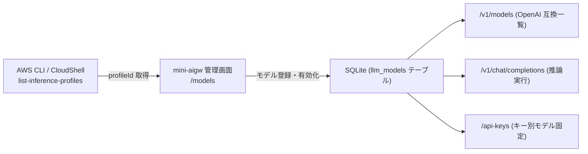

# Amazon Bedrock モデル情報取得・登録ガイド (Foundation Models & Inference Profiles)

本ドキュメントは、`mini-aigw` の Web 管理画面（`/models`）や設定ファイル（`.env` の `DEFAULT_MODEL_ID`）で利用する **Amazon Bedrock の基盤モデル ID（Foundation Model ID）および推論プロファイル ID（Inference Profile ID）** の確認・取得方法、およびシステムへの登録手順をまとめたガイドです。

---

## 1. 概要と背景（なぜ `profileId` を登録するのか）

Amazon Bedrock では、モデルの呼び出し方式として以下の 2 種類が存在します：

1. **推論プロファイル（Inference Profile / `profileId`） 【推奨・標準】**:
   - Anthropic Claude 3.5 / 3.7 / 4 系や Amazon Nova など、昨今の主要モデルでは**クロスリージョン推論プロファイル（Cross-Region Inference Profile）** の利用が必須または強く推奨されています。
   - `apac.`（アジア太平洋）、`jp.`（日本国内）、`us.`（米国）、`global.`（グローバル）等のプレフィックスが付与された ID を使用することで、可用性・スループットの向上やリージョン間の自動負荷分散が行われます。
   - **`mini-aigw` では、管理画面の「モデル登録」においてこの `profileId` をそのまま登録して使用します。**
2. **基盤モデル ID（Foundation Model ID / `modelId`）**:
   - 推論プロファイルが定義されていない一部の基盤モデルや特定リージョン単独モデルでは、単体の `modelId`（例: `amazon.titan-text-express-v1` 等）を指定します。

`mini-aigw` のモデル管理機能は、これら双方の ID（およびカスタムモデル ARN）に対応しています。

---

## 2. 事前準備：モデルアクセスの有効化（Model Access）

> [!IMPORTANT]
> Amazon Bedrock のモデルを API や `mini-aigw` から呼び出すには、AWS アカウント上で対象モデルへのアクセス権が付与されている必要があります。

1. **AWS マネジメントコンソール** にログインします。
2. リージョンを運用対象リージョン（例: `ap-northeast-1` 東京リージョン）に切り替えます。
3. **Amazon Bedrock** サービス画面を開き、左側ナビゲーションメニュー最下部の **「Model access（モデルアクセス）」** をクリックします。
4. 利用したいモデル（例: Anthropic Claude 3.5 Sonnet, Amazon Nova Lite 等）のステータスが **「Access granted（アクセス許可済み）」** になっていることを確認します。
5. 未有効化の場合は、「Modify model access」ボタンをクリックして対象モデルにチェックを入れ、リクエストを送信して有効化（即時または承認後付与）してください。

---

## 3. モデル情報の取得方法 (AWS CLI / CloudShell)

AWS マネジメントコンソールの **AWS CloudShell**、または作業端末の **AWS CLI** から以下のコマンドを実行することで、現在利用可能なモデル一覧を簡単に取得できます。

### 3.1 推論プロファイル一覧の取得 (`list-inference-profiles`) 【推奨】

利用可能なアクティブ状態の推論プロファイル（`profileId`）の一覧を取得します。

```bash
aws bedrock list-inference-profiles --region ap-northeast-1 \
  --query "inferenceProfileSummaries[?status=='ACTIVE'].{
    profileId:inferenceProfileId,
    profileName:inferenceProfileName,
    type:type
  }" \
  --output table
```

#### 出力例:

```text
---------------------------------------------------------------------------------------------------------------
---------------------------------------------------------------------------------------------------------------
|                                            ListInferenceProfiles                                            |
+---------------------------------------------------+---------------------------------------+-----------------+
|                     profileId                     |              profileName              |      type       |
+---------------------------------------------------+---------------------------------------+-----------------+
|  apac.anthropic.claude-3-sonnet-20240229-v1:0     |  APAC Anthropic Claude 3 Sonnet       |  SYSTEM_DEFINED |
|  apac.anthropic.claude-3-5-sonnet-20240620-v1:0   |  APAC Anthropic Claude 3.5 Sonnet     |  SYSTEM_DEFINED |
|  apac.anthropic.claude-3-haiku-20240307-v1:0      |  APAC Anthropic Claude 3 Haiku        |  SYSTEM_DEFINED |
|  apac.anthropic.claude-3-5-sonnet-20241022-v2:0   |  APAC Anthropic Claude 3.5 Sonnet v2  |  SYSTEM_DEFINED |
|  apac.amazon.nova-micro-v1:0                      |  APAC Nova Micro                      |  SYSTEM_DEFINED |
|  apac.amazon.nova-lite-v1:0                       |  APAC Nova Lite                       |  SYSTEM_DEFINED |
|  apac.amazon.nova-pro-v1:0                        |  APAC Nova Pro                        |  SYSTEM_DEFINED |
|  jp.anthropic.claude-sonnet-4-5-20250929-v1:0     |  JP Anthropic Claude Sonnet 4.5       |  SYSTEM_DEFINED |
|  apac.anthropic.claude-sonnet-4-20250514-v1:0     |  APAC Claude Sonnet 4                 |  SYSTEM_DEFINED |
|  jp.anthropic.claude-haiku-4-5-20251001-v1:0      |  JP Anthropic Claude Haiku 4.5        |  SYSTEM_DEFINED |
|  jp.amazon.nova-2-lite-v1:0                       |  JP Amazon Nova 2 Lite                |  SYSTEM_DEFINED |
|  global.amazon.nova-2-lite-v1:0                   |  GLOBAL Amazon Nova 2 Lite            |  SYSTEM_DEFINED |
|  global.anthropic.claude-opus-4-5-20251101-v1:0   |  GLOBAL Anthropic Claude Opus 4.5     |  SYSTEM_DEFINED |
|  global.anthropic.claude-sonnet-4-5-20250929-v1:0 |  Global Claude Sonnet 4.5             |  SYSTEM_DEFINED |
|  global.anthropic.claude-haiku-4-5-20251001-v1:0  |  Global Anthropic Claude Haiku 4.5    |  SYSTEM_DEFINED |
|  global.openai.gpt-5.6-sol                        |  Global OpenAI GPT-5.6 Sol            |  SYSTEM_DEFINED |
|  global.openai.gpt-5.6-terra                      |  Global OpenAI GPT-5.6 Terra          |  SYSTEM_DEFINED |
|  global.xai.grok-4.6                              |  Global xAI Grok 4.6                  |  SYSTEM_DEFINED |
|  global.anthropic.claude-opus-5-5                 |  Global Anthropic Claude Opus 5.5     |  SYSTEM_DEFINED |
|  global.anthropic.claude-sonnet-5-5               |  Global Anthropic Claude Sonnet 5.5   |  SYSTEM_DEFINED |
+---------------------------------------------------+---------------------------------------+-----------------+
```

> [!TIP]
> **リージョンプレフィックスの選び方**:
> - `apac.*`: アジア太平洋地域（東京・シドニー・シンガポール等）での推論。日本国内からのアクセスでレイテンシが低く最も推奨されます。
> - `jp.*`: 日本国内リージョン限定の推論。データ主権やコンプライアンス要件が厳格な場合に最適です。
> - `global.*` / `us.*`: 最新モデルや特定の大規模モデルで APAC/JP に未展開の場合に使用します。

---

### 3.2 単体基盤モデル一覧の取得 (`list-foundation-models`)

推論プロファイルを経由しない単体モデルやオンデマンド提供モデルの一覧を確認したい場合は、以下を実行します：

```bash
aws bedrock list-foundation-models --region ap-northeast-1 \
  --by-inference-type ON_DEMAND \
  --query "modelSummaries[?modelLifecycle.status=='ACTIVE'].{
    modelId:modelId,
    modelName:modelName,
    providerName:providerName
  }" \
  --output table
```

---

## 4. `mini-aigw` へのモデル登録手順

取得した `profileId`（または `modelId`）を `mini-aigw` に登録して、Web UI や API から利用できるように設定します。

### 4.1 Web 管理画面からの動的登録

1. ブラウザで `mini-aigw` 管理画面（`http://localhost:8000/models`）にアクセスします。
2. **「新規モデルの登録」** フォームに以下を入力します：
   - **Bedrock モデル ID / ARN**: 取得した `profileId` を入力（例: `apac.anthropic.claude-3-5-sonnet-20241022-v2:0`）
   - **表示名**: 利用者にわかりやすい名前（例: `Claude 3.5 Sonnet v2`）
   - **プロバイダ**: `bedrock`（既定値）
   - **説明・用途メモ (任意)**: モデルの特徴や用途（例: `高性能推論・コード生成用フラグシップモデル`）
3. **「モデルを登録」** をクリックします。
4. 登録されたモデルの行で **「既定にする」** をクリックすると、システム全体のデフォルトモデルとして設定できます。また、「無効化」ボタンでクライアントへの露出を一時停止できます。



### 4.2 設定ファイル (`.env`) による初期既定モデルの設定

サーバー起動時の既定モデルを指定したい場合は、`.env` ファイルの `DEFAULT_MODEL_ID` に設定します。

```env
# サーバー起動時のデフォルトモデル ID (推論プロファイル ID または 基盤モデル ID)
DEFAULT_MODEL_ID=apac.anthropic.claude-3-5-sonnet-20241022-v2:0
```

### 4.3 業務チャット用 API キーへのモデル紐付け (`/api-keys`)

「API キー管理 (`/api-keys`)」画面で新しい API キーを発行する際、「固定モデル」に登録したモデルを指定できます。これにより、特定のチャットボットや部署の用途に合わせて利用モデルを統制・制限できます。

---

## 5. クライアントからの呼び出し確認

### 5.1 公開モデル一覧の確認 (`/v1/models`)

登録したモデルが OpenAI 互換 API 経由で取得できるか確認します：

```bash
curl -X GET http://localhost:8000/v1/models \
  -H "Authorization: Bearer sk-live-..."
```

**応答例:**
```json
{
  "object": "list",
  "data": [
    {
      "id": "apac.anthropic.claude-3-5-sonnet-20241022-v2:0",
      "object": "model",
      "created": 1729219200,
      "owned_by": "bedrock"
    }
  ]
}
```

### 5.2 チャット推論のテスト (`/v1/chat/completions`)

登録した `profileId` を `model` 引数に指定してリクエストを送信します：

```bash
curl -X POST http://localhost:8000/v1/chat/completions \
  -H "Content-Type: application/json" \
  -H "Authorization: Bearer sk-live-..." \
  -d '{
    "model": "apac.anthropic.claude-3-5-sonnet-20241022-v2:0",
    "messages": [
      {"role": "user", "content": "こんにちは！"}
    ]
  }'
```

---

## 6. トラブルシューティング

| 現象・エラー | 想定原因 | 対処方法 |
| :--- | :--- | :--- |
| **`AccessDeniedException`**<br>`You don't have access to the model with the specified model ID.` | 対象モデルのアクセス権が有効化されていない。 | AWS コンソールの **Bedrock > Model access** で対象モデルにアクセス許可が付与されているか確認してください。 |
| **`ValidationException`**<br>`The provided model identifier is invalid.` | `profileId` または `modelId` のスペルミス、またはリージョン非対応。 | `aws bedrock list-inference-profiles` の出力結果から `profileId` の文字列をそのままコピー＆ペーストしてください。 |
| **推論時にタイムアウト / 接続エラー** | 閉域 VPC 環境で VPC エンドポイント（`bedrock-runtime`）の通信が遮断されている。 | VPC エンドポイントのセキュリティグループ（443/TCP 受信許可）およびプライベート DNS が有効になっているか確認してください（詳細は [OFFLINE_DEPLOYMENT_GUIDE.md](OFFLINE_DEPLOYMENT_GUIDE.md) 参照）。 |

---

## 7. 関連ドキュメント

- [README.md - mini-aigw 全体仕様・起動手順](../README.md)
- [docs/OFFLINE_DEPLOYMENT_GUIDE.md - 閉域・オフライン環境向けデプロイ・運用手順書](OFFLINE_DEPLOYMENT_GUIDE.md)
- [docs/BEDROCK_KB_SPEC_AND_TROUBLESHOOTING.md - Bedrock Managed Knowledge Base 検索仕様・トラブルシューティング](BEDROCK_KB_SPEC_AND_TROUBLESHOOTING.md)
- [DESIGN.md - システム設計書](../DESIGN.md)

> [!TIP]
> **リージョンプレフィックスの選び方**:
> - `apac.*`: アジア太平洋地域（東京・シドニー・シンガポール等）での推論。日本国内からのアクセスでレイテンシが低く最も推奨されます。
> - `jp.*`: 日本国内リージョン限定の推論。データ主権やコンプライアンス要件が厳格な場合に最適です。
> - `global.*` / `us.*`: 最新モデルや特定の大規模モデルで APAC/JP に未展開の場合に使用します。

---

### 3.2 単体基盤モデル一覧の取得 (`list-foundation-models`)

推論プロファイルを経由しない単体モデルやオンデマンド提供モデルの一覧を確認したい場合は、以下を実行します：

```bash
aws bedrock list-foundation-models --region ap-northeast-1 \
  --by-inference-type ON_DEMAND \
  --query "modelSummaries[?modelLifecycle.status=='ACTIVE'].{
    modelId:modelId,
    modelName:modelName,
    providerName:providerName
  }" \
  --output table
```

---

## 4. `mini-aigw` へのモデル登録手順

取得した `profileId`（または `modelId`）を `mini-aigw` に登録して、Web UI や API から利用できるように設定します。

### 4.1 Web 管理画面からの動的登録

1. ブラウザで `mini-aigw` 管理画面（`http://localhost:8000/models`）にアクセスします。
2. **「新規モデルの登録」** フォームに以下を入力します：
   - **Bedrock モデル ID / ARN**: 取得した `profileId` を入力（例: `apac.anthropic.claude-3-5-sonnet-20241022-v2:0`）
   - **表示名**: 利用者にわかりやすい名前（例: `Claude 3.5 Sonnet v2`）
   - **プロバイダ**: `bedrock`（既定値）
   - **説明・用途メモ (任意)**: モデルの特徴や用途（例: `高性能推論・コード生成用フラグシップモデル`）
3. **「モデルを登録」** をクリックします。
4. 登録されたモデルの行で **「既定にする」** をクリックすると、システム全体のデフォルトモデルとして設定できます。また、「無効化」ボタンでクライアントへの露出を一時停止できます。


### 4.2 設定ファイル (`.env`) による初期既定モデルの設定

サーバー起動時の既定モデルを指定したい場合は、`.env` ファイルの `DEFAULT_MODEL_ID` に設定します。

```env
# サーバー起動時のデフォルトモデル ID (推論プロファイル ID または 基盤モデル ID)
DEFAULT_MODEL_ID=apac.anthropic.claude-3-5-sonnet-20241022-v2:0
```

### 4.3 業務チャット用 API キーへのモデル紐付け (`/api-keys`)

「API キー管理 (`/api-keys`)」画面で新しい API キーを発行する際、「固定モデル」に登録したモデルを指定できます。これにより、特定のチャットボットや部署の用途に合わせて利用モデルを統制・制限できます。

---

## 5. クライアントからの呼び出し確認

### 5.1 公開モデル一覧の確認 (`/v1/models`)

登録したモデルが OpenAI 互換 API 経由で取得できるか確認します：

```bash
curl -X GET http://localhost:8000/v1/models \
  -H "Authorization: Bearer sk-live-..."
```

**応答例:**
```json
{
  "object": "list",
  "data": [
    {
      "id": "apac.anthropic.claude-3-5-sonnet-20241022-v2:0",
      "object": "model",
      "created": 1729219200,
      "owned_by": "bedrock"
    }
  ]
}
```

### 5.2 チャット推論のテスト (`/v1/chat/completions`)

登録した `profileId` を `model` 引数に指定してリクエストを送信します：

```bash
curl -X POST http://localhost:8000/v1/chat/completions \
  -H "Content-Type: application/json" \
  -H "Authorization: Bearer sk-live-..." \
  -d '{
    "model": "apac.anthropic.claude-3-5-sonnet-20241022-v2:0",
    "messages": [
      {"role": "user", "content": "こんにちは！"}
    ]
  }'
```

---

## 6. トラブルシューティング

| 現象・エラー | 想定原因 | 対処方法 |
| :--- | :--- | :--- |
| **`AccessDeniedException`**<br>`You don't have access to the model with the specified model ID.` | 対象モデルのアクセス権が有効化されていない。 | AWS コンソールの **Bedrock > Model access** で対象モデルにアクセス許可が付与されているか確認してください。 |
| **`ValidationException`**<br>`The provided model identifier is invalid.` | `profileId` または `modelId` のスペルミス、またはリージョン非対応。 | `aws bedrock list-inference-profiles` の出力結果から `profileId` の文字列をそのままコピー＆ペーストしてください。 |
| **推論時にタイムアウト / 接続エラー** | 閉域 VPC 環境で VPC エンドポイント（`bedrock-runtime`）の通信が遮断されている。 | VPC エンドポイントのセキュリティグループ（443/TCP 受信許可）およびプライベート DNS が有効になっているか確認してください（詳細は [OFFLINE_DEPLOYMENT_GUIDE.md](OFFLINE_DEPLOYMENT_GUIDE.md) 参照）。 |

---

## 7. 関連ドキュメント

- [README.md - mini-aigw 全体仕様・起動手順](../README.md)
- [docs/OFFLINE_DEPLOYMENT_GUIDE.md - 閉域・オフライン環境向けデプロイ・運用手順書](OFFLINE_DEPLOYMENT_GUIDE.md)
- [docs/BEDROCK_KB_SPEC_AND_TROUBLESHOOTING.md - Bedrock Managed Knowledge Base 検索仕様・トラブルシューティング](BEDROCK_KB_SPEC_AND_TROUBLESHOOTING.md)
- [DESIGN.md - システム設計書](../DESIGN.md)

