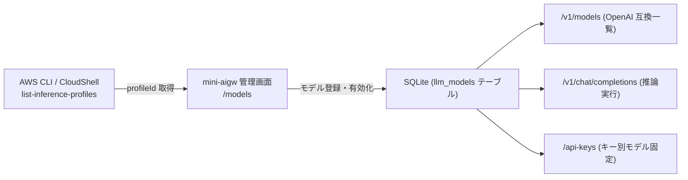

# Amazon Bedrock モデル情報取得・登録ガイド (Foundation Models & Inference Profiles)

本ドキュメントは、`mini-aigw` の Web 管理画面（`/models`）や設定ファイル（`.env` の `DEFAULT_MODEL_ID`）で利用する **Amazon Bedrock の基盤モデル ID（Foundation Model ID）および推論プロファイル ID（Inference Profile ID）** の確認・取得方法、およびシステムへの登録手順をまとめたガイドです。

---

## 1. 概要と背景（なぜ `profileId` を登録するのか）

Amazon Bedrock では、モデルの呼び出し方式として以下の 2 種類が存在します：

1. **推論プロファイル（Inference Profile / `profileId`） 【推奨・標準】**:
   - Anthropic Claude 4/5 系や Amazon Nova など、昨今の主要モデルでは**クロスリージョン推論プロファイル（Cross-Region Inference Profile）** の利用が必須または強く推奨されています。
   - `apac.`（アジア太平洋）、`jp.`（日本国内）、`us.`（米国）、`global.`（グローバル）等のプレフィックスが付与された ID を使用することで、可用性・スループットの向上やリージョン間の自動負荷分散が行われます。
   - **`mini-aigw` では、管理画面の「モデル登録」においてこの `profileId` をそのまま登録して使用します。**
2. **基盤モデル ID（Foundation Model ID / `modelId`）**:
   - 推論プロファイルが定義されていない一部の基盤モデルや特定リージョン単独モデルでは、単体の `modelId`（例: `amazon.titan-text-express-v1` 等）を指定します。

`mini-aigw` のモデル管理機能は、これら双方の ID（およびカスタムモデル ARN）に対応しています。

---

## 2. 前提知識：モデルアクセスの自動有効化と権限管理 (IAM)

> [!NOTE]
> **「Model access（モデルアクセス）」画面の廃止と自動有効化について**:
> 以前の Amazon Bedrock ではコンソールの「Model access」画面からモデルごとに手動で有効化申請（`Modify model access`）を行う必要がありましたが、**この機能・画面は廃止（リタイア）されました**。
> 現在は、ほぼすべてのサーバーレス基盤モデルが各 AWS リージョンで**自動的に有効化**されており、事前の手動申請なしに即座に利用（推論）できます。

### 2.1 アクセス制御の方針（IAM ポリシーによる制御）
モデルがデフォルトで有効化されるようになったため、モデルの利用可否やセキュリティ統制は **AWS IAM ポリシー**（または AWS Organizations の SCP: サービスコントロールポリシー）で行います。

`mini-aigw` が動作する EC2 インスタンスの IAM ロール（インスタンスプロファイル）に、以下の推論権限が付与されていることを確認してください：
- `bedrock:InvokeModel`
- `bedrock:InvokeModelWithResponseStream`

特定のモデルのみに利用を制限したい場合は、IAM ポリシーの `Resource` 句に対象モデルや推論プロファイルの ARN を指定して制限します。また、`mini-aigw` の Web 管理画面（`/models`）で有効/無効を切り替えたり、「API キー管理（`/api-keys`）」でキーごとに利用可能なモデルを制限することも可能です。

### 2.2 サードパーティモデル（Anthropic 等）の初回同意
Anthropic などの一部のモデル（AWS Marketplace 経由の基盤モデル）では、AWS アカウントで初めて利用する際に、Bedrock コンソールの Playground でのモデル選択時などにユースケース情報の送信（Use case details）や利用規約（EULA）への同意が求められる場合があります。API 呼び出しでアクセスエラーとなる場合は、一度 AWS コンソールの Bedrock Playground で該当モデルを選択し、初回同意を完了させてください。

### 2.3 特定モデルにおけるアカウント別提供制限 (`is not available for this account`)

> [!WARNING]
> **「... is not available for this account」エラーについて**:
> 一部の最新・上位基盤モデル（Anthropic Claude の最上位・新モデルなど）を呼び出した際、以下のエラーが発生することがあります：
> ```text
> AccessDeniedException: <model_id> is not available for this account. 
> You can explore other available models on Amazon Bedrock. 
> For additional access options, contact AWS Sales at https://aws.amazon.com/contact-us/sales-support/
> ```
> 
> **発生要因と背景**:
> - **アカウントの利用実績・種別による制限**: AWS 側でインフラキャパシティ管理のため、アカウントの開設期間、過去の課金実績、利用パターン等に基づきモデルごとに利用枠を制御しています。個人利用アカウントや開設直後の新規アカウントでは、特定モデルへのアクセスがデフォルトで制限（またはサービスクォータが 0）されている場合があります。
> - **IAM 権限不足との違い**: 単純な IAM ポリシー不足（`is not authorized to perform: bedrock:InvokeModel`）ではなく、**AWS 側のアカウント単位のエンタイトルメント（提供資格）によるブロック**です。そのため、EC2 の IAM ロールにフル権限を与えてもこのエラーは解消しません。
> - **対処方法**:
>   1. **広く一般開放されているモデルを利用する**: 最初はアカウント制限が厳しくないモデル（例: `apac.amazon.nova-lite-v1:0`, `jp.amazon.nova-2-lite-v1:0`, `apac.anthropic.claude-3-haiku-20240307-v1:0`, `apac.anthropic.claude-3-5-sonnet-20241022-v2:0` 等）でテスト・稼働させることを推奨します。
>   2. **初回同意・ユースケース送信の完了**: AWS コンソールの Bedrock Playground で該当モデルを選択し、利用規約（EULA）やユースケース提出（Submit use case details）が求められる場合は完了させます。
>   3. **Service Quotas の確認**: AWS コンソールの **Service Quotas ➔ AWS のサービス ➔ Amazon Bedrock** で該当モデルのクォータ（Tokens per minute 等）が 0 になっていないか確認し、必要に応じて引き上げをリクエストします。
>   4. **AWS Sales / サポートへの問い合わせ**: 業務要件等でどうしても該当モデルの利用が必須な場合は、エラーメッセージに記載の [AWS Sales Support](https://aws.amazon.com/contact-us/sales-support/) または AWS サポートケースを通じてモデルアクセスのアンブロックをご相談ください。

---

## 3. モデル情報の取得方法 (AWS CLI / CloudShell)

AWS マネジメントコンソールの **AWS CloudShell**、または作業端末の **AWS CLI** から以下のコマンドを実行することで、現在利用可能なモデル一覧を簡単に取得できます。

### 3.1 推論プロファイル一覧の取得 (`list-inference-profiles`) 【推奨】

利用可能なアクティブ状態の推論プロファイル（`profileId`）の一覧を取得します。

```bash
aws bedrock list-inference-profiles --region ap-northeast-1 \
  --query "inferenceProfileSummaries[?status=='ACTIVE'].{
    profileId:inferenceProfileId,
    profileName:inferenceProfileName,
    type:type
  }" \
  --output table
```

#### 出力例:

```text
---------------------------------------------------------------------------------------------------------------
|                                            ListInferenceProfiles                                            |
+---------------------------------------------------+---------------------------------------+-----------------+
|                     profileId                     |              profileName              |      type       |
+---------------------------------------------------+---------------------------------------+-----------------+
|  apac.anthropic.claude-3-sonnet-20240229-v1:0     |  APAC Anthropic Claude 3 Sonnet       |  SYSTEM_DEFINED |
|  apac.anthropic.claude-3-5-sonnet-20240620-v1:0   |  APAC Anthropic Claude 3.5 Sonnet     |  SYSTEM_DEFINED |
|  apac.anthropic.claude-3-haiku-20240307-v1:0      |  APAC Anthropic Claude 3 Haiku        |  SYSTEM_DEFINED |
|  apac.anthropic.claude-3-5-sonnet-20241022-v2:0   |  APAC Anthropic Claude 3.5 Sonnet v2  |  SYSTEM_DEFINED |
|  apac.amazon.nova-micro-v1:0                      |  APAC Nova Micro                      |  SYSTEM_DEFINED |
|  apac.amazon.nova-lite-v1:0                       |  APAC Nova Lite                       |  SYSTEM_DEFINED |
|  apac.amazon.nova-pro-v1:0                        |  APAC Nova Pro                        |  SYSTEM_DEFINED |
|  jp.anthropic.claude-sonnet-4-5-20250929-v1:0     |  JP Anthropic Claude Sonnet 4.5       |  SYSTEM_DEFINED |
|  global.cohere.embed-v4:0                         |  Global Cohere Embed v4               |  SYSTEM_DEFINED |
|  apac.anthropic.claude-sonnet-4-20250514-v1:0     |  APAC Claude Sonnet 4                 |  SYSTEM_DEFINED |
|  jp.anthropic.claude-haiku-4-5-20251001-v1:0      |  JP Anthropic Claude Haiku 4.5        |  SYSTEM_DEFINED |
|  global.twelvelabs.pegasus-1-2-v1:0               |  GLOBAL TwelveLabs Pegasus v1.2       |  SYSTEM_DEFINED |
|  global.amazon.nova-2-lite-v1:0                   |  GLOBAL Amazon Nova 2 Lite            |  SYSTEM_DEFINED |
|  jp.amazon.nova-2-lite-v1:0                       |  JP Amazon Nova 2 Lite                |  SYSTEM_DEFINED |
|  global.anthropic.claude-opus-4-5-20251101-v1:0   |  GLOBAL Anthropic Claude Opus 4.5     |  SYSTEM_DEFINED |
|  jp.anthropic.claude-sonnet-4-6                   |  JP Anthropic Claude Sonnet 4.6       |  SYSTEM_DEFINED |
|  jp.anthropic.claude-opus-4-7                     |  JP Anthropic Claude Opus 4.7         |  SYSTEM_DEFINED |
|  global.anthropic.claude-opus-4-6-v1              |  Global Anthropic Claude Opus 4.6     |  SYSTEM_DEFINED |
|  global.anthropic.claude-sonnet-4-5-20250929-v1:0 |  Global Claude Sonnet 4.5             |  SYSTEM_DEFINED |
|  global.anthropic.claude-sonnet-4-20250514-v1:0   |  Global Claude Sonnet 4               |  SYSTEM_DEFINED |
|  jp.anthropic.claude-opus-4-8                     |  JP Anthropic Claude Opus 4.8         |  SYSTEM_DEFINED |
|  global.anthropic.claude-haiku-4-5-20251001-v1:0  |  Global Anthropic Claude Haiku 4.5    |  SYSTEM_DEFINED |
|  global.anthropic.claude-fable-5                  |  Global Anthropic Claude Fable 5      |  SYSTEM_DEFINED |
|  global.openai.gpt-5.6-sol                        |  Global OpenAI GPT-5.6 Sol            |  SYSTEM_DEFINED |
|  global.openai.gpt-5.6-terra                      |  Global OpenAI GPT-5.6 Terra          |  SYSTEM_DEFINED |
|  global.xai.grok-4.6                              |  Global xAI Grok 4.6                  |  SYSTEM_DEFINED |
|  global.anthropic.claude-fable-5-1                |  Global Anthropic Claude Fable 5.1    |  SYSTEM_DEFINED |
|  global.twelvelabs.pegasus-1-5-v1:0               |  Global TwelveLabs Pegasus v1.5       |  SYSTEM_DEFINED |
|  global.openai.gpt-6-sol                          |  Global OpenAI GPT-6 Sol              |  SYSTEM_DEFINED |
|  jp.anthropic.claude-opus-5-5                     |  JP Anthropic Claude Opus 5.5         |  SYSTEM_DEFINED |
|  global.anthropic.claude-opus-5-5                 |  Global Anthropic Claude Opus 5.5     |  SYSTEM_DEFINED |
|  global.openai.gpt-5.4                            |  Global OpenAI GPT 5.4                |  SYSTEM_DEFINED |
|  global.openai.gpt-5.5                            |  Global OpenAI GPT 5.5                |  SYSTEM_DEFINED |
|  global.anthropic.claude-opus-5                   |  Global Anthropic Claude Opus 5       |  SYSTEM_DEFINED |
|  global.anthropic.claude-opus-4-8                 |  Global Anthropic Claude Opus 4.8     |  SYSTEM_DEFINED |
|  global.anthropic.claude-sonnet-5                 |  Global Anthropic Claude Sonnet 5     |  SYSTEM_DEFINED |
|  global.anthropic.claude-opus-4-7                 |  Global Anthropic Claude Opus 4.7     |  SYSTEM_DEFINED |
|  global.xai.grok-4.7                              |  Global xAI Grok 4.7                  |  SYSTEM_DEFINED |
|  global.openai.gpt-6-astra                        |  Global OpenAI GPT-6 Astra            |  SYSTEM_DEFINED |
|  global.openai.gpt-6.1-sol                        |  Global OpenAI GPT-6.1 Sol            |  SYSTEM_DEFINED |
|  global.zai.glm-5.3                               |  Global Z.AI GLM 5.3                  |  SYSTEM_DEFINED |
|  global.anthropic.claude-sonnet-4-6               |  Global Anthropic Claude Sonnet 4.6   |  SYSTEM_DEFINED |
|  global.moonshotai.kimi-k3                        |  Global Moonshot AI Kimi K3           |  SYSTEM_DEFINED |
|  jp.anthropic.claude-haiku-5-5                    |  JP Anthropic Claude Haiku 5.5        |  SYSTEM_DEFINED |
|  global.anthropic.claude-haiku-5-5                |  Global Anthropic Claude Haiku 5.5    |  SYSTEM_DEFINED |
|  global.anthropic.claude-sonnet-5-5               |  Global Anthropic Claude Sonnet 5.5   |  SYSTEM_DEFINED |
|  global.openai.gpt-5.6-luna                       |  Global OpenAI GPT-5.6 Luna           |  SYSTEM_DEFINED |
|  global.openai.gpt-6-luna                         |  Global OpenAI GPT-6 Luna             |  SYSTEM_DEFINED |
+---------------------------------------------------+---------------------------------------+-----------------+
```

> [!TIP]
> **リージョンプレフィックスの選び方**:
> - `apac.*`: アジア太平洋地域（東京・シドニー・シンガポール等）での推論。日本国内からのアクセスでレイテンシが低く最も推奨されます。
> - `jp.*`: 日本国内リージョン限定の推論。データ主権やコンプライアンス要件が厳格な場合に最適です。
> - `global.*` / `us.*`: 最新モデルや特定の大規模モデルで APAC/JP に未展開の場合に使用します。

---

### 3.2 単体基盤モデル一覧の取得 (`list-foundation-models`)

推論プロファイルを経由しない単体モデルやオンデマンド提供モデルの一覧を確認したい場合は、以下を実行します：

```bash
aws bedrock list-foundation-models --region ap-northeast-1 \
  --by-inference-type ON_DEMAND \
  --query "modelSummaries[?modelLifecycle.status=='ACTIVE'].{
    modelId:modelId,
    modelName:modelName,
    providerName:providerName
  }" \
  --output table
```

---

### 3.3 モデル料金・トークン単価の取得 (`aws pricing get-products`)

Amazon Bedrock の各基盤モデルの利用料金（入力トークン・出力トークンあたりの単価）は、**AWS Price List API（Pricing CLI）** を用いてコマンドラインから取得できます。

> [!NOTE]
> **Price List API のエンドポイント指定**:
> AWS Price List API のサービスエンドポイントはグローバルで `us-east-1`（米国東部）または `ap-south-1`（ムンバイ）等に集約されています。そのため、コマンドの `--region` には `us-east-1` を指定し、**料金を取得したい対象リージョンは `--filters` 内の `Field=regionCode`（例: `ap-northeast-1`（東京））で指定**します。

#### 東京リージョン (`ap-northeast-1`) の特定モデル料金を取得する例:

```bash
aws pricing get-products --region us-east-1 --service-code AmazonBedrockFoundationModels \
  --filters 'Type=TERM_MATCH,Field=servicename,Value=Claude Haiku 5.5 (Amazon Bedrock Edition)' \
            'Type=TERM_MATCH,Field=regionCode,Value=ap-northeast-1'
```

#### 整形して入力・出力単価（USD）を一覧表示する例 (`jq` 利用):

取得される JSON の `PriceList` から、利用タイプごとの単価（1,000 トークンあたりの USD 料金）を抽出しやすくするには、以下のように `jq` で整形します：

```bash
aws pricing get-products --region us-east-1 --service-code AmazonBedrockFoundationModels \
  --filters 'Type=TERM_MATCH,Field=servicename,Value=Claude Haiku 5.5 (Amazon Bedrock Edition)' \
            'Type=TERM_MATCH,Field=regionCode,Value=ap-northeast-1' \
  --query 'PriceList' --output text | jq -r '
    .terms.OnDemand | to_entries[] | .value.priceDimensions | to_entries[] |
    "\(.value.description) --> \(.value.pricePerUnit.USD) USD / \(.value.unit)"
  '
```

> [!TIP]
> **東京リージョンで提供されているモデル名称（`servicename`）一覧の確認**:
> フィルターに指定する `servicename` の正確な値を確認したい場合は、以下を実行します：
> ```bash
> aws pricing get-products --region us-east-1 --service-code AmazonBedrockFoundationModels \
>   --filters 'Type=TERM_MATCH,Field=regionCode,Value=ap-northeast-1' \
>   --query 'PriceList' --output text | jq -r '.product.attributes.servicename' | sort -u
> ```

---

## 4. `mini-aigw` へのモデル登録手順

取得した `profileId`（または `modelId`）を `mini-aigw` に登録して、Web UI や API から利用できるように設定します。

### 4.1 Web 管理画面からの動的登録

1. ブラウザで `mini-aigw` 管理画面（`http://localhost:8000/models`）にアクセスします。
2. **「新規モデルの登録」** フォームに以下を入力します：
   - **Bedrock モデル ID / ARN**: 取得した `profileId` を入力（例: `jp.anthropic.claude-haiku-5-5`）
   - **表示名**: 利用者にわかりやすい名前（例: `Claude 3.5 Sonnet v2` または `Claude Haiku 5.5`）
   - **プロバイダ**: `bedrock`（既定値）
   - **Temperature (サンプリング) パラメータ送信**: 通常モデルは ON（送信）。Claude Haiku 5.5 や Claude Sonnet 5 等の新世代モデルでは **OFF（除外）** に設定します。
   - **説明・用途メモ (任意)**: モデルの特徴や用途（例: `高性能推論・コード生成用フラグシップモデル`）
3. **「モデルを登録」** をクリックします。
4. 登録されたモデルの行で **「既定にする」** をクリックすると、システム全体のデフォルトモデルとして設定できます。「編集」から後からサンプリング送信フラグや単価を変更することも可能です。また、「無効化」ボタンでクライアントへの露出を一時停止できます。



### 4.2 設定ファイル (`.env`) による初期既定モデルの設定

サーバー起動時の既定モデルを指定したい場合は、`.env` ファイルの `DEFAULT_MODEL_ID` に設定します。

```env
# サーバー起動時のデフォルトモデル ID (推論プロファイル ID または 基盤モデル ID)
DEFAULT_MODEL_ID=jp.amazon.nova-2-lite-v1:0
```

### 4.3 業務チャット用 API キーへのモデル紐付け (`/api-keys`)

「API キー管理 (`/api-keys`)」画面で新しい API キーを発行する際、「固定モデル」に登録したモデルを指定できます。これにより、特定のチャットボットや部署の用途に合わせて利用モデルを統制・制限できます。

---

## 5. クライアントからの呼び出し確認

### 5.1 公開モデル一覧の確認 (`/v1/models`)

登録したモデルが OpenAI 互換 API 経由で取得できるか確認します：

```bash
curl -X GET http://localhost:8000/v1/models \
  -H "Authorization: Bearer sk-live-..."
```

**応答例:**
```json
{
  "object": "list",
  "data": [
    {
      "id": "jp.anthropic.claude-haiku-5-5",
      "object": "model",
      "created": 1729219200,
      "owned_by": "bedrock"
    }
  ]
}
```

### 5.2 チャット推論のテスト (`/v1/chat/completions`)

登録した `profileId` を `model` 引数に指定してリクエストを送信します：

```bash
curl -X POST http://localhost:8000/v1/chat/completions \
  -H "Content-Type: application/json" \
  -H "Authorization: Bearer sk-live-..." \
  -d '{
    "model": "jp.anthropic.claude-haiku-5-5",
    "messages": [
      {"role": "user", "content": "こんにちは！"}
    ]
  }'
```

---

## 6. トラブルシューティング

| 現象・エラー | 想定原因 | 対処方法 |
| :--- | :--- | :--- |
| **`AccessDeniedException`**<br>`<model_id> is not available for this account.`<br>`... contact AWS Sales at https://...` | AWS 側によるアカウント単位のモデル提供制限（アカウント利用実績・キャパシティ要因）、またはサービスクォータが 0。 | **IAM 権限不足ではありません。**<br>1. まずは広く一般開放されているモデル（`apac.amazon.nova-lite-v1:0`, `jp.amazon.nova-2-lite-v1:0`, `apac.anthropic.claude-3-5-sonnet-20241022-v2:0` 等）で動作確認を行ってください。<br>2. Bedrock コンソールの Playground でモデル選択時に初回利用規約（EULA）やユースケース送信（Use case details）が求められないか確認してください。<br>3. Service Quotas で該当モデルのクォータを確認・申請するか、必要に応じて AWS Sales 窓口または AWS サポートへご相談ください（詳細は [2.3 特定モデルにおけるアカウント別提供制限](#23-特定モデルにおけるアカウント別提供制限-is-not-available-for-this-account) 参照）。 |
| **`AccessDeniedException`**<br>`User: ... is not authorized to perform: bedrock:InvokeModel` | EC2 の IAM ロールに対象モデルの推論権限がない、または SCP 等で拒否されている。 | EC2 の IAM ロールに `bedrock:InvokeModel` / `bedrock:InvokeModelWithResponseStream` が許可されているか（SCP 等でブロックされていないか）確認してください。 |
| **`ValidationException`**<br>`The provided model identifier is invalid.` | `profileId` または `modelId` のスペルミス、またはリージョン非対応。 | `aws bedrock list-inference-profiles` の出力結果から `profileId` の文字列をそのままコピー＆ペーストしてください。 |
| **`ValidationException`**<br>`The model returned the following errors: temperature is deprecated for this model` | Claude Haiku 5.5（`claude-haiku-5-5`）や Sonnet 5、Opus 4.7 等の新世代モデルでは、`temperature` / `top_p` などの従来のサンプリングパラメータが廃止されています。 | 管理画面（`/models`）で該当モデルの「編集」を開き、**「Temperature (サンプリング) パラメータを送信する」を OFF（除外）** に設定してください。<br>これにより、クライアント（OpenAI SDK等）が `temperature` を指定して送ってきた場合でも、mini-aigw が Bedrock 向け payload からサンプリングパラメータを自動除外し、エラーなく推論を完遂させます。 |
| **推論時にタイムアウト / 接続エラー** | 閉域 VPC 環境で VPC エンドポイント（`bedrock-runtime`）の通信が遮断されている。 | VPC エンドポイントのセキュリティグループ（443/TCP 受信許可）およびプライベート DNS が有効になっているか確認してください（詳細は [OFFLINE_DEPLOYMENT_GUIDE.md](OFFLINE_DEPLOYMENT_GUIDE.md) 参照）。 |

---

## 7. 関連ドキュメント

- [README.md - mini-aigw 全体仕様・起動手順](../README.md)
- [docs/OFFLINE_DEPLOYMENT_GUIDE.md - 閉域・オフライン環境向けデプロイ・運用手順書](OFFLINE_DEPLOYMENT_GUIDE.md)
- [docs/BEDROCK_KB_SPEC_AND_TROUBLESHOOTING.md - Bedrock Managed Knowledge Base 検索仕様・トラブルシューティング](BEDROCK_KB_SPEC_AND_TROUBLESHOOTING.md)
- [DESIGN.md - システム設計書](../DESIGN.md)


